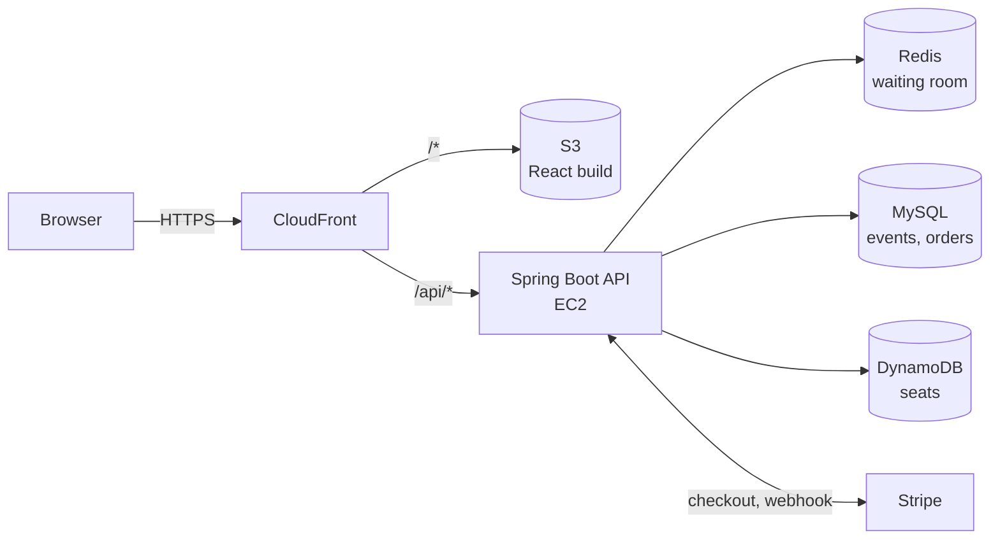

# Lineup - Event Ticketing System

[](https://github.com/CEMcode404/event-ticketing-system/actions/workflows/backend-ci.yml)
[](https://github.com/CEMcode404/event-ticketing-system/actions/workflows/frontend-ci.yml)

A Ticketmaster-style ticket sale with a virtual waiting room. Visitors join a queue, get admitted in controlled batches, hold seats, and pay through Stripe. Deployed to AWS with Terraform and load-tested with k6.

## Results

Measured on AWS against a single `t4g.small` API instance (2 vCPU, 2 GB):

| Test | Result |
|---|---|
| 10,000 users joining a queue within 60 s | 0 errors, join p95 47 ms |
| 500 shoppers competing for 1,000 seats | 0 double bookings, verified against both databases |
| Arrivals ramping up to 800 users/s | ~12,000 concurrent users, ~3,700 req/s, 0 errors |

Three bottlenecks were found and fixed along the way. Raw outputs and notes: [`loadtest/results/`](loadtest/results/).

## Architecture



- **No double bookings by design:** every hold and sale is a DynamoDB conditional transaction, so a race fails and retries instead of overselling.
- **The waiting room bounds load:** at most 500 people shop at once, however large the queue.
- **Webhook as source of truth:** orders are paid only via Stripe's webhook, with idempotent fulfillment and automatic refunds if a hold expired.
- **Least-privilege infrastructure:** Terraform runs as a restricted IAM user with permissions boundaries; no SSH, secrets in SSM.

## Tech stack

Java 25 · Spring Boot 4 · React 19 · TypeScript · Tailwind CSS · MySQL · DynamoDB · Redis · Stripe · Auth0 · Terraform · AWS · k6 · Testcontainers · GitHub Actions

## Running locally

### Prerequisites

- Java 25, Node.js 22+ with pnpm, Docker Desktop
- [Stripe CLI](https://docs.stripe.com/stripe-cli) (`brew install stripe/stripe-cli/stripe`)
- An [Auth0](https://auth0.com) tenant with a SPA application and an API
- A [Stripe](https://stripe.com) account in test mode

### Setup (first time only)

```bash
cp api/src/main/resources/application-local.properties.example api/src/main/resources/application-local.properties
cp frontend/.env.local.example frontend/.env.local
stripe login
```

Fill in your Auth0 values and Stripe test key in both files. The webhook secret (`whsec_...`) is printed by `stripe listen` below. Both files are git-ignored.

### Run

Use four terminal tabs:

```bash
docker compose up -d                  # 1. MySQL, Redis, DynamoDB Local

stripe listen --events checkout.session.completed,checkout.session.expired \
  --forward-to localhost:8080/api/webhooks/stripe        # 2. webhooks

cd api && ./mvnw spring-boot:run -Dspring-boot.run.profiles=local   # 3. API

cd frontend && pnpm install && pnpm dev                  # 4. frontend
```

Open http://localhost:5173, sign in at `/admin/login`, create and publish an event, then join its queue from a private window. Pay with Stripe's test card `4242 4242 4242 4242`.

### Useful commands

```bash
docker compose down -v        # reset all local data
cd api && ./mvnw test         # backend tests (needs Docker)
pnpm lint && pnpm build       # frontend checks (from frontend/)
```

Load testing and AWS deployment: see [`loadtest/`](loadtest/) and [`terraform/`](terraform/).